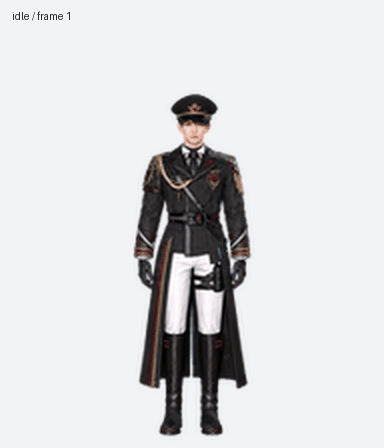

# 夏以昼 · Caleb Pet

以《恋与深空》夏以昼的黑色军装设定为参考制作的透明动画宠物。包含可直接运行的浏览器播放器、Windows 桌面程序和完整动画素材。



## 克隆后立即使用

```sh
git clone https://github.com/yoyo2985/caleb_pet.git
cd caleb_pet
```

双击 `index.html`，即可在浏览器里播放，无需服务器、账号或 API 密钥。可以拖动角色，选择九种动作，并开启鼠标视线跟随。如果浏览器限制本地文件，可在项目目录执行 `python -m http.server 8000`，打开 http://localhost:8000 。

## Windows 桌面宠物

需要 Python 3.10 或更新版本，安装依赖后启动：

```sh
python -m pip install -r requirements.txt
python pet.py
```

左键拖动，右键选择动作或退出，Esc 退出。Windows 支持透明背景和置顶。其他系统可以运行 Tkinter 播放器，但保留紫色背景；Linux 可能需要额外安装系统的 python3-tk。桌面程序播放九种动作，鼠标视线跟随由浏览器版提供。

## 素材与结构

- `assets/spritesheet.png`：成品 v2 精灵图，1536×2288 RGBA，8 列、11 行，每格 192×208。
- `assets/reference.png`：已确认的角色外观。
- `manifest.json`：动作、帧数、每帧时长和图像校验值；`manifest.js` 是浏览器无需 fetch 的同内容副本。
- `source/`：生成的原始动作和视线条带，用于后续调整。
- `previews/`：动作预览与视线预览。
- `scripts/check_assets.py`：校验素材，或导出 73 个有效单帧。

```sh
python scripts/check_assets.py
python scripts/check_assets.py --export exported-frames
```

前九行依次是 idle、running-right、running-left、waving、jumping（槽位保留，画面改为敬礼）、failed、waiting、running（思考）、review；帧数为 6、8、8、4、5、8、6、6、6。最后两行是 16 个顺时针视线方向，从正上方开始。共有 73 个有效帧、15 个透明空格。部分邻近视线方向变化较细微。

## 制作与 ChatGPT Pets

原始条带使用图像生成工具，以确认的人物外观作为参考；随后提取帧、去除背景、统一比例与脚底位置、组装并检查。成品通过结构、透明背景、方向语义和动作预览检查。重新生成画面需要图像生成工具；运行现有宠物不需要。

这是独立可运行的分发包。克隆不会自动创建或激活 ChatGPT Work 中的宠物；若拥有支持自定义宠物的 Pets 工具，可将 `assets/spritesheet.png` 作为 v2 素材，通过对应创建流程导入。仓库没有个人宠物 ID、账号凭据或机器绝对路径。

## 授权与归属

项目新编写的播放器和工具代码采用 MIT 许可，见 LICENSE。夏以昼及《恋与深空》相关角色设计属于原权利人；本项目为非官方同人作品。MIT 许可不授予原角色或其设计的权利，素材不应被当作官方资源或商业授权。


## 2026-10-29 更新：待机与敬礼

待机改为呼吸、眨眼、轻微左右看与重心变化。角色两侧增加较多细短竖线，以 #DAA000 和 #000DAA 为目标色，柔化边缘并上下错落，表现重力感。

原 `jumping` 槽位现在是五帧原地敬礼：抬手、敬礼停顿、放下，脚底不离地。保留槽位名称以兼容 ChatGPT Pets 格式。浏览器版和桌面版鼠标进入角色区域时播放一次敬礼，然后回到待机；拖动过程中不重新触发。GPT 内的触发时机、时长和后续状态由宿主决定，更新素材不修改宿主逻辑。没有增加自动踱步。

GPT 和本仓库使用同一份成品精灵图。`manifest.json` 的时长供本地播放器使用，不会传入 GPT。成品预览见 [待机—敬礼—待机](previews/idle-salute-idle.gif)。检查记录在 `qa/`；跳跃离地检查按用户要求设为零，完整说明见 `qa/revision-notes.json`。

如已克隆，执行 `git pull` 更新。可运行 `node --test scripts/test_player.cjs` 验证悬停敬礼一次后返回待机，以及拖动不重新触发。
